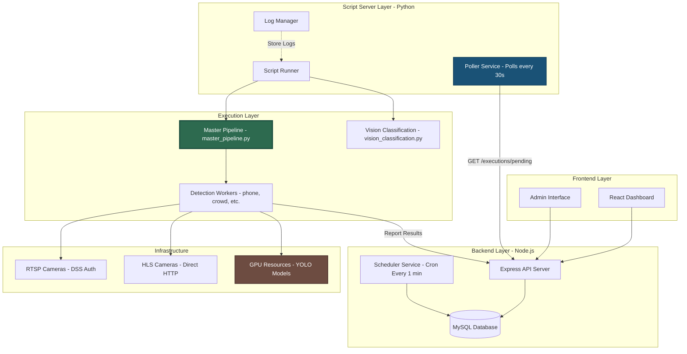
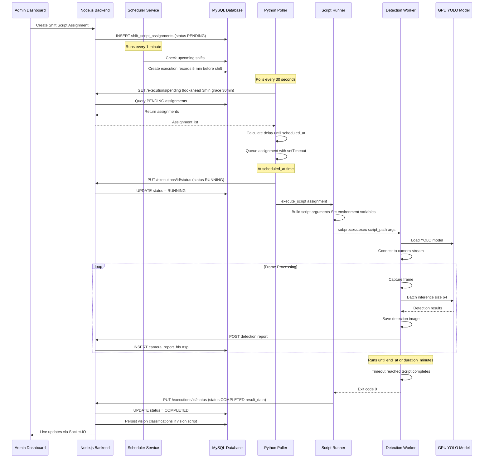
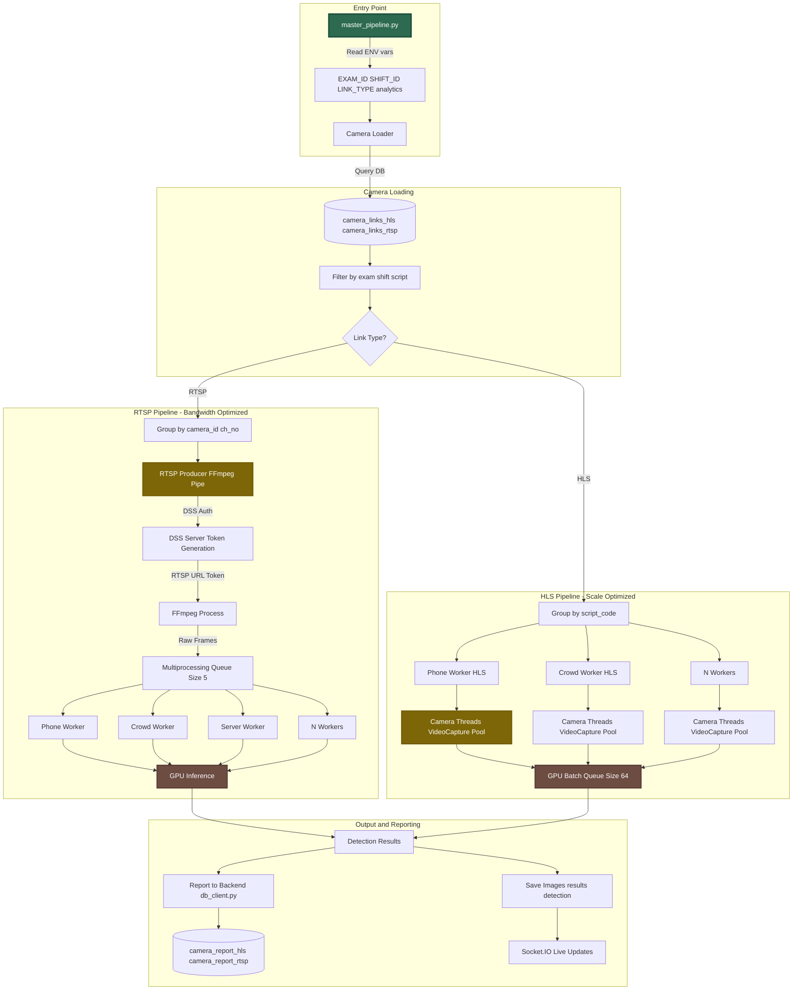
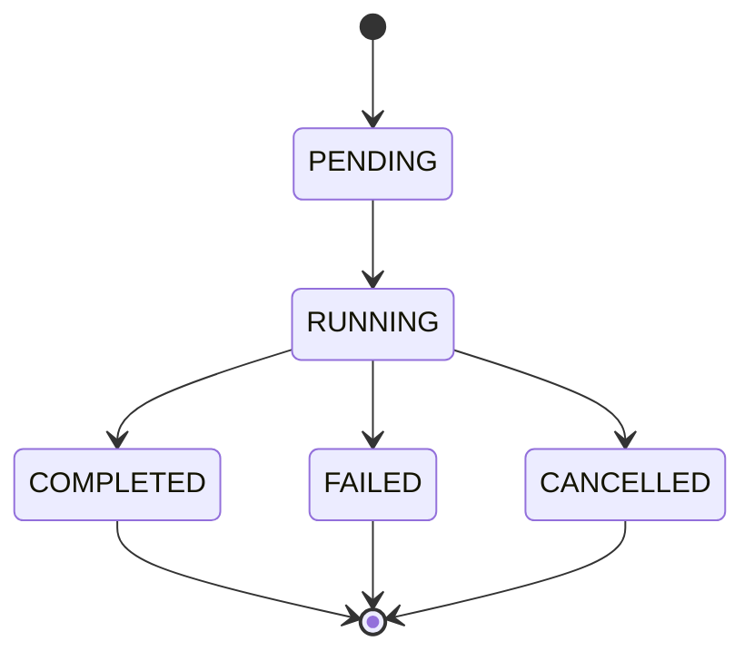
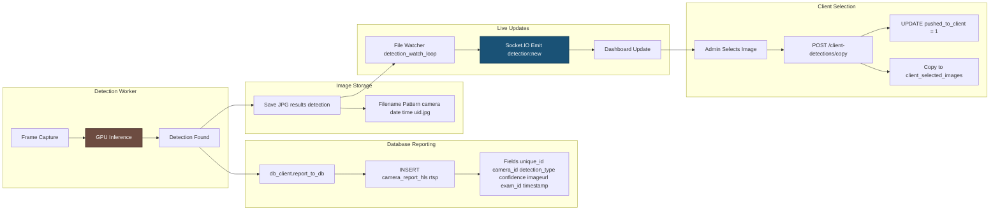
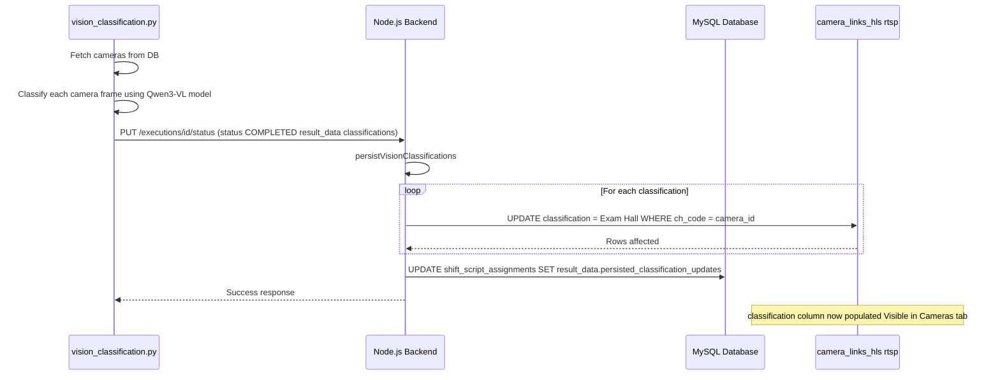
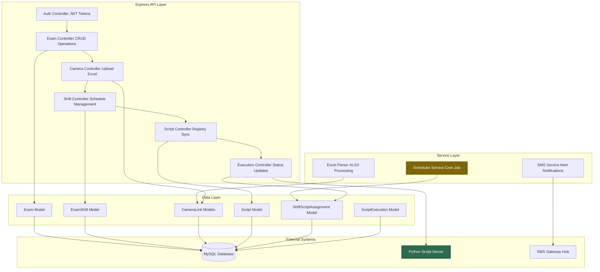
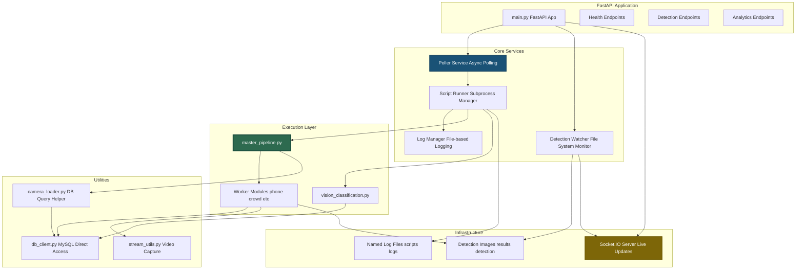

```mermaid
flowchart TD
    START([Admin Creates Exam]) --> EXAM[Exam Created start_date end_date skip_days skip_dates]
    EXAM --> SHIFT[Create Exam Shifts Morning 09:00-12:00 Afternoon 14:00-17:00]
    SHIFT --> SCRIPT[Assign Scripts to Shifts phone crowd server etc]
    
    SCRIPT --> BULK[Bulk Assignment Creation]
    BULK --> DATES{Calculate Assignable Dates}
    
    DATES -->|Filter| SKIP_DAYS[Remove skip_days eg Sunday]
    SKIP_DAYS --> SKIP_DATES[Remove skip_dates eg 2026-02-20]
    SKIP_DATES --> VALID[Valid Date Range 2026-02-15 to 2026-02-28]
    
    VALID --> INSERT[INSERT shift_script_assignments One row per date per script status PENDING]
    
    INSERT --> CRON[Scheduler Cron Job Runs every 1 minute]
    
    CRON --> CHECK{Check Time}
    CHECK -->|5 min before custom_start_time| READY[Assignment Ready]
    CHECK -->|Not yet| WAIT[Wait for next cycle]
    WAIT --> CRON
    
    READY --> POLL[Poller Fetches GET /executions/pending]
    POLL --> QUEUE[Queue Assignment Calculate delay]
    
    QUEUE --> DELAY{Delay greater than 0?}
    DELAY -->|Yes| SCHEDULE[asyncio.sleep delay]
    DELAY -->|No| IMMEDIATE[Run Immediately]
    
    SCHEDULE --> EXECUTE[Execute Script]
    IMMEDIATE --> EXECUTE
    
    EXECUTE --> RUNNING[Status RUNNING started_at NOW]
    RUNNING --> WORKER[Worker Process Detection Loop]
    
    WORKER --> TIMEOUT{Timeout Reached?}
    TIMEOUT -->|No| DETECT[Process Frame Save Detection]
    DETECT --> WORKER
    
    TIMEOUT -->|Yes| COMPLETE[Status COMPLETED completed_at NOW]
    COMPLETE --> PERSIST[Persist Results result_data images]
    
    PERSIST --> END([Assignment Complete])

    style EXAM fill:#1a5276,color:#ffffff,stroke:#154360,stroke-width:2px
    style CRON fill:#7d6608,color:#ffffff,stroke:#6d5800,stroke-width:2px
    style EXECUTE fill:#2d6a4f,color:#ffffff,stroke:#1b4d3e,stroke-width:2px
    style COMPLETE fill:#4a235a,color:#ffffff,stroke:#3b1a4a,stroke-width:2px
```

<!-- # CCTV Detection System - Complete Workflow Documentation

> **Comprehensive guide to understanding single script execution and the master pipeline orchestration**

---

## Table of Contents

1. [System Architecture Overview](#system-architecture-overview)
2. [Single Script Execution Flow](#single-script-execution-flow)
3. [Master Pipeline Workflow](#master-pipeline-workflow)
4. [Scheduling & Assignment Flow](#scheduling--assignment-flow)
5. [Data Flow & Persistence](#data-flow--persistence)
6. [Component Interactions](#component-interactions)

---

## System Architecture Overview



---

## Single Script Execution Flow

### Overview
This flow shows how a **single analytics assignment** (e.g., "Run Phone Detection on Camera X") progresses from scheduling to completion.



### Key Phases

#### **Phase A: Discovery & Dispatch**
- **Poller** queries backend API every 30 seconds
- Backend returns assignments within lookahead window (3 min) or grace period (30 min overdue)
- Poller calculates exact delay and schedules via `asyncio.sleep()`

#### **Phase B: Process Bootstrapping**
- **Script Runner** injects environment variables:
  - `CAMERA_ID`, `STREAM_URL`, `EXECUTION_ID`
  - `EXAM_ID`, `SHIFT_ID`, `ASSIGNMENT_DATE`, `LINK_TYPE`
- Spawns subprocess with `asyncio.create_subprocess_exec()`
- Creates named log file: `scripts/logs/{ScriptName}_{Exam}_{Shift}_{Date}.log`

#### **Phase C: Worker Runtime**
- Worker loads YOLO model on GPU
- Connects to camera stream (RTSP or HLS)
- Processes frames in batches (typically 64 frames)
- Saves detection images to `results/` directory
- Reports detections to backend via REST API

#### **Phase D: Lifecycle Management**
- Runner monitors subprocess with timeout (from `end_at` or `duration_minutes`)
- Captures stdout/stderr and streams to log files
- On timeout: sends SIGTERM to process group
- Updates assignment status to COMPLETED/FAILED
- Cleans up resources and log handlers

---

## Master Pipeline Workflow

### Overview
The **Master Pipeline** (`master_pipeline.py`) orchestrates multiple cameras and analytics scripts simultaneously, optimized for both RTSP and HLS streams.



### RTSP vs HLS Strategy

#### **RTSP Pipeline (Camera-Centric)**
- **One Producer per Camera**: Single FFmpeg process connects to DSS server
- **Frame Distribution**: Producer feeds frames to multiple worker queues via multiprocessing
- **Bandwidth Efficient**: Camera stream decoded once, shared across all analytics
- **DSS Authentication**: Generates MD5 signature, fetches session token
- **Reconnection Logic**: Re-authenticates after 10 consecutive frame failures

#### **HLS Pipeline (Analytics-Centric)**
- **One Worker per Analytics Type**: Each worker manages its own camera pool
- **Thread-Based**: Worker spawns threads for each camera using `cv2.VideoCapture`
- **GPU Batch Queue**: Accumulates frames from all cameras, processes in batches of 64
- **Scale Optimized**: Can handle hundreds of cameras per worker
- **Direct HTTP**: No authentication required, pulls snapshots directly

### Worker Lazy Loading

```python
def get_worker(analytic_name, mode="rtsp"):
    """
    Dynamically imports workers to prevent loading unused models.
    Only the requested analytics load their YOLO models into GPU memory.
    """
    mapping = {
        "server":      ("server_room_worker",      "server_room_worker",      "server_room_worker_hls"),
        "crowd":       ("crowd_worker",            "crowd_worker",            "crowd_worker_hls"),
        "phone":       ("phone_worker",            "phone_worker",            "phone_worker_hls"),
        # ... 13 total analytics
    }
    module_name, rtsp_fn, hls_fn = mapping[analytic_name]
    module = importlib.import_module(f"workers.{module_name}")
    fn_name = rtsp_fn if mode == "rtsp" else hls_fn
    return getattr(module, fn_name)
```

---

## Scheduling & Assignment Flow

### Complete Scheduling Lifecycle


### Assignment Status Lifecycle



**Status Transitions:**

- **PENDING → RUNNING**: Poller picks up assignment at `scheduled_at` time
- **RUNNING → COMPLETED**: Script exits with code 0 OR timeout reached
- **RUNNING → FAILED**: Script exits with non-zero code OR exception thrown
- **RUNNING → CANCELLED**: Manual cancellation via `POST /executions/{id}/cancel`

**Status Metadata:**

| Status | Fields |
|--------|--------|
| PENDING | `created_at`, `scheduled_at`, `custom_start_time` |
| RUNNING | `started_at`, subprocess spawned, logs streaming |
| COMPLETED | `completed_at`, `result_data` (JSON), images saved |
| FAILED | `completed_at`, `error_log` |
| CANCELLED | `completed_at`, `error_log` |

---

## Data Flow & Persistence

### Detection Result Flow



### Vision Classification Persistence



---

## Component Interactions

### Backend Services Architecture



### Script Server Architecture



---

## Key Concepts Summary

### 1. **Distributed Architecture**
- **Backend**: Node.js handles API, scheduling, and database operations
- **Script Server**: Python handles heavy computation, GPU inference, and video processing
- **Separation of Concerns**: Backend manages state, Script Server executes workloads

### 2. **Scheduling Strategy**
- **Proactive Scheduling**: Scheduler creates assignments 5 minutes before shift start
- **Polling Model**: Script server polls for upcoming assignments every 30 seconds
- **Precise Timing**: Poller uses `asyncio.sleep()` to fire scripts at exact `scheduled_at` time
- **Overnight Shifts**: Supports shifts that cross midnight (end_at on next day)

### 3. **Execution Isolation**
- **Process per Assignment**: Each script runs in isolated subprocess
- **Environment Variables**: Metadata passed via ENV vars (EXAM_ID, SHIFT_ID, etc.)
- **Named Logs**: Separate log file per script execution for debugging
- **Graceful Shutdown**: SIGTERM handling for clean resource cleanup

### 4. **Pipeline Optimization**
- **RTSP**: One FFmpeg process per camera, frames distributed to multiple workers
- **HLS**: One worker per analytics type, manages pool of camera threads
- **Lazy Loading**: Workers only load their required YOLO models
- **GPU Batching**: Accumulates frames for efficient batch inference

### 5. **Data Persistence**
- **Dual Storage**: Images saved to filesystem, metadata to MySQL
- **Unique IDs**: Each detection has UUID for tracking and client selection
- **Live Updates**: Socket.IO broadcasts new detections in real-time
- **Classification Storage**: Vision results persisted to camera_links table

### 6. **Error Handling**
- **Retry Logic**: RTSP producer re-authenticates after 10 frame failures
- **Timeout Management**: Scripts terminated gracefully after duration_minutes
- **Status Tracking**: PENDING → RUNNING → COMPLETED/FAILED/CANCELLED
- **Log Preservation**: All stdout/stderr captured for post-mortem analysis

---

## Appendix: Script Registry

### Available Analytics Scripts

| Script Code | Name | Description | Link Type | Worker Module |
|-------------|------|-------------|-----------|---------------|
| `phone` | Phone Detection | Detects mobile phone usage | RTSP/HLS | phone_worker.py |
| `crowd` | Crowd Detection | Detects crowding | RTSP/HLS | crowd_worker.py |
| `crowd_zero` | Zero Person Detection | Detects empty rooms | RTSP/HLS | crowd_zero_det_worker.py |
| `crowd_five` | Low Person Count (<5) | Detects low occupancy | RTSP/HLS | crowd_five_det_worker.py |
| `server` | Server Room Detection | Detects unauthorized access | RTSP/HLS | server_room_worker.py |
| `intruder` | Intruder Detection | Detects unauthorized persons | RTSP/HLS | intruder_worker.py |
| `entry_exit` | Entry/Exit Tracking | Tracks movement patterns | RTSP/HLS | entry_exit_worker.py |
| `proximity` | Proximity Detection | Detects close proximity violations | RTSP/HLS | close_proximity_worker.py |
| `invigilator` | Invigilator Tracking | Tracks invigilator presence | RTSP/HLS | invigilator_worker.py |
| `vision` | Scene Classification | Classifies camera scenes (Qwen3-VL) | RTSP/HLS | vision_classification.py |
| `inversion` | Camera Inversion | Detects rotated/inverted cameras | RTSP/HLS | camera_inversion_worker.py |
| `tampering` | Camera Tampering | Detects blur/blockage/tampering | RTSP/HLS | camera_tampering_worker.py |
| `blind_spot` | Blind Spot Detection | Detects blind spots and static issues | RTSP/HLS | blind_spot_worker.py |


**Document Version**: 1.0  
**Last Updated**: 2026-04-22  
**Maintained By**: CCTV Analytics Team -->


# CCTV Detection System - Complete Workflow Documentation

> **Comprehensive guide to understanding single script execution and the master pipeline orchestration**

---

## Table of Contents

1. [System Architecture Overview](#system-architecture-overview)
2. [Single Script Execution Flow](#single-script-execution-flow)
3. [Master Pipeline Workflow](#master-pipeline-workflow)
4. [Scheduling & Assignment Flow](#scheduling--assignment-flow)
5. [Data Flow & Persistence](#data-flow--persistence)
6. [Component Interactions](#component-interactions)
7. [Complete System Flow Diagram](#complete-system-flow-diagram)

---

## System Architecture Overview


---

## Single Script Execution Flow

### Overview
This flow shows how a **single analytics assignment** (e.g., "Run Phone Detection on Camera X") progresses from scheduling to completion.


### Key Phases

#### **Phase A: Discovery & Dispatch**
- **Poller** queries backend API every 30 seconds
- Backend returns assignments within lookahead window (3 min) or grace period (30 min overdue)
- Poller calculates exact delay and schedules via `asyncio.sleep()`

#### **Phase B: Process Bootstrapping**
- **Script Runner** injects environment variables:
  - `CAMERA_ID`, `STREAM_URL`, `EXECUTION_ID`
  - `EXAM_ID`, `SHIFT_ID`, `ASSIGNMENT_DATE`, `LINK_TYPE`
- Spawns subprocess with `asyncio.create_subprocess_exec()`
- Creates named log file: `scripts/logs/{ScriptName}_{Exam}_{Shift}_{Date}.log`

#### **Phase C: Worker Runtime**
- Worker loads YOLO model on GPU
- Connects to camera stream (RTSP or HLS)
- Processes frames in batches (typically 64 frames)
- Saves detection images to `results/` directory
- Reports detections to backend via REST API

#### **Phase D: Lifecycle Management**
- Runner monitors subprocess with timeout (from `end_at` or `duration_minutes`)
- Captures stdout/stderr and streams to log files
- On timeout: sends SIGTERM to process group
- Updates assignment status to COMPLETED/FAILED
- Cleans up resources and log handlers

---

## Master Pipeline Workflow

### Overview
The **Master Pipeline** (`master_pipeline.py`) orchestrates multiple cameras and analytics scripts simultaneously, optimized for both RTSP and HLS streams.


### RTSP vs HLS Strategy

#### **RTSP Pipeline (Camera-Centric)**
- **One Producer per Camera**: Single FFmpeg process connects to DSS server
- **Frame Distribution**: Producer feeds frames to multiple worker queues via multiprocessing
- **Bandwidth Efficient**: Camera stream decoded once, shared across all analytics
- **DSS Authentication**: Generates MD5 signature, fetches session token
- **Reconnection Logic**: Re-authenticates after 10 consecutive frame failures

#### **HLS Pipeline (Analytics-Centric)**
- **One Worker per Analytics Type**: Each worker manages its own camera pool
- **Thread-Based**: Worker spawns threads for each camera using `cv2.VideoCapture`
- **GPU Batch Queue**: Accumulates frames from all cameras, processes in batches of 64
- **Scale Optimized**: Can handle hundreds of cameras per worker
- **Direct HTTP**: No authentication required, pulls snapshots directly

### Worker Lazy Loading

```python
def get_worker(analytic_name, mode="rtsp"):
    """
    Dynamically imports workers to prevent loading unused models.
    Only the requested analytics load their YOLO models into GPU memory.
    """
    mapping = {
        "server":      ("server_room_worker",      "server_room_worker",      "server_room_worker_hls"),
        "crowd":       ("crowd_worker",            "crowd_worker",            "crowd_worker_hls"),
        "phone":       ("phone_worker",            "phone_worker",            "phone_worker_hls"),
        # ... 13 total analytics
    }
    module_name, rtsp_fn, hls_fn = mapping[analytic_name]
    module = importlib.import_module(f"workers.{module_name}")
    fn_name = rtsp_fn if mode == "rtsp" else hls_fn
    return getattr(module, fn_name)
```

---

## Scheduling & Assignment Flow

### Complete Scheduling Lifecycle



### Assignment Status Lifecycle


**Status Transitions:**

- **PENDING → RUNNING**: Poller picks up assignment at `scheduled_at` time
- **RUNNING → COMPLETED**: Script exits with code 0 OR timeout reached
- **RUNNING → FAILED**: Script exits with non-zero code OR exception thrown
- **RUNNING → CANCELLED**: Manual cancellation via `POST /executions/{id}/cancel`

**Status Metadata:**

| Status | Fields |
|--------|--------|
| PENDING | `created_at`, `scheduled_at`, `custom_start_time` |
| RUNNING | `started_at`, subprocess spawned, logs streaming |
| COMPLETED | `completed_at`, `result_data` (JSON), images saved |
| FAILED | `completed_at`, `error_log` |
| CANCELLED | `completed_at`, `error_log` |

---

## Data Flow & Persistence

### Detection Result Flow


### Vision Classification Persistence


---

## Component Interactions

### Backend Services Architecture


### Script Server Architecture


---

## Key Concepts Summary

### 1. **Distributed Architecture**
- **Backend**: Node.js handles API, scheduling, and database operations
- **Script Server**: Python handles heavy computation, GPU inference, and video processing
- **Separation of Concerns**: Backend manages state, Script Server executes workloads

### 2. **Scheduling Strategy**
- **Proactive Scheduling**: Scheduler creates assignments 5 minutes before shift start
- **Polling Model**: Script server polls for upcoming assignments every 30 seconds
- **Precise Timing**: Poller uses `asyncio.sleep()` to fire scripts at exact `scheduled_at` time
- **Overnight Shifts**: Supports shifts that cross midnight (end_at on next day)

### 3. **Execution Isolation**
- **Process per Assignment**: Each script runs in isolated subprocess
- **Environment Variables**: Metadata passed via ENV vars (EXAM_ID, SHIFT_ID, etc.)
- **Named Logs**: Separate log file per script execution for debugging
- **Graceful Shutdown**: SIGTERM handling for clean resource cleanup

### 4. **Pipeline Optimization**
- **RTSP**: One FFmpeg process per camera, frames distributed to multiple workers
- **HLS**: One worker per analytics type, manages pool of camera threads
- **Lazy Loading**: Workers only load their required YOLO models
- **GPU Batching**: Accumulates frames for efficient batch inference

### 5. **Data Persistence**
- **Dual Storage**: Images saved to filesystem, metadata to MySQL
- **Unique IDs**: Each detection has UUID for tracking and client selection
- **Live Updates**: Socket.IO broadcasts new detections in real-time
- **Classification Storage**: Vision results persisted to camera_links table

### 6. **Error Handling**
- **Retry Logic**: RTSP producer re-authenticates after 10 frame failures
- **Timeout Management**: Scripts terminated gracefully after duration_minutes
- **Status Tracking**: PENDING → RUNNING → COMPLETED/FAILED/CANCELLED
- **Log Preservation**: All stdout/stderr captured for post-mortem analysis

---

## Appendix: Script Registry

### Available Analytics Scripts

| Script Code | Name | Description | Link Type | Worker Module |
|-------------|------|-------------|-----------|---------------|
| `phone` | Phone Detection | Detects mobile phone usage | RTSP/HLS | phone_worker.py |
| `crowd` | Crowd Detection | Detects crowding | RTSP/HLS | crowd_worker.py |
| `crowd_zero` | Zero Person Detection | Detects empty rooms | RTSP/HLS | crowd_zero_det_worker.py |
| `crowd_five` | Low Person Count (<5) | Detects low occupancy | RTSP/HLS | crowd_five_det_worker.py |
| `server` | Server Room Detection | Detects unauthorized access | RTSP/HLS | server_room_worker.py |
| `intruder` | Intruder Detection | Detects unauthorized persons | RTSP/HLS | intruder_worker.py |
| `entry_exit` | Entry/Exit Tracking | Tracks movement patterns | RTSP/HLS | entry_exit_worker.py |
| `proximity` | Proximity Detection | Detects close proximity violations | RTSP/HLS | close_proximity_worker.py |
| `invigilator` | Invigilator Tracking | Tracks invigilator presence | RTSP/HLS | invigilator_worker.py |
| `vision` | Scene Classification | Classifies camera scenes (Qwen3-VL) | RTSP/HLS | vision_classification.py |
| `inversion` | Camera Inversion | Detects rotated/inverted cameras | RTSP/HLS | camera_inversion_worker.py |
| `tampering` | Camera Tampering | Detects blur/blockage/tampering | RTSP/HLS | camera_tampering_worker.py |
| `blind_spot` | Blind Spot Detection | Detects blind spots and static issues | RTSP/HLS | blind_spot_worker.py |

---

## Complete System Flow Diagram

> End-to-end flow covering all seven stages: admin & scheduling → polling & dispatch → script runner → master pipeline (RTSP/HLS) → detection workers → frame processing loop → lifecycle & completion.

```mermaid
flowchart TD
    %% ─── SECTION 1: ADMIN & SCHEDULING ───
    A1([🖥️ Admin Dashboard\nCreate exam · shifts · script assignments])
    A2[Node.js Express API\nAuth · exams · cameras · shifts · executions]
    A3[(MySQL Database\nshift_script_assignments — PENDING)]
    A4[⏱️ Scheduler Service\nCron every 1 min · creates executions 5 min before shift]

    A1 --> A2
    A2 --> A3
    A3 --> A4

    %% ─── SECTION 2: POLLING & DISPATCH ───
    B1[🐍 Python Poller\nGET /executions/pending · polls every 30 s · lookahead 3 min]
    B2[Calculate delay to scheduled_at\nasyncio.sleep — or run immediately]
    B3[PUT /executions/id/status\nStatus → RUNNING · started_at = NOW]

    A4 --> B1
    B1 --> B2
    B2 --> B3

    %% ─── SECTION 3: SCRIPT RUNNER ───
    C1[Script Runner\nInject ENV vars · spawn subprocess · create named log file]
    C2[master_pipeline.py\nMulti-camera orchestration]
    C3[vision_classification.py\nQwen3-VL scene classification]

    B3 --> C1
    C1 --> C2
    C1 --> C3

    %% ─── SECTION 4: MASTER PIPELINE — RTSP vs HLS ───
    D1{Link type?\nRead LINK_TYPE env var}
    D2[RTSP Producer\nFFmpeg + DSS auth\n1 FFmpeg process per camera]
    D3[HLS Worker Pool\n1 worker per analytic\nthreads per camera]
    D4[Multiprocessing Queue\nsize 5 · frames shared\nacross all workers]
    D5[GPU Batch Queue\n64-frame batches\nacross all cameras]

    C2 --> D1
    D1 -->|RTSP| D2
    D1 -->|HLS| D3
    D2 --> D4
    D3 --> D5

    %% ─── SECTION 5: DETECTION WORKERS ───
    E1[Detection Workers\nphone · crowd · server · intruder · proximity · … 13 total\nLazy-loaded YOLO models]
    E2[GPU YOLO Inference\nLoad model · batch frames · get detections]

    D4 --> E1
    D5 --> E1
    E1 --> E2

    %% ─── SECTION 6: FRAME PROCESSING LOOP ───
    F1[Detection Found\nconfidence + bounding box metadata]
    F2[Save Detection Image\nresults/detection · UUID filename]
    F3[Report to Backend\nPOST detection via db_client.py]
    F4[(INSERT camera_report_hls / rtsp\nunique_id · camera_id · confidence · imageurl)]
    F5[File Watcher → Socket.IO\ndetection:new → dashboard live update]
    F6{Timeout reached?}

    E2 --> F1
    F1 --> F2
    F1 --> F3
    F3 --> F4
    F2 --> F5
    F1 --> F6
    F6 -->|No — next frame| E2
    F6 -->|Yes| G1

    %% ─── SECTION 7: LIFECYCLE & COMPLETION ───
    G1[Timeout / script exits\nSIGTERM to process group · cleanup resources]
    G2[PUT /executions/id/status\nStatus → COMPLETED / FAILED · result_data saved]
    G3[Persist vision classifications\nif vision script — UPDATE camera_links.classification]
    G4[Socket.IO → admin dashboard\nLive status update · assignment reflected]
    G5[Admin selects detections for client\nPOST /client-detections/copy · pushed_to_client = 1]
    G6([✅ Assignment Complete])

    G1 --> G2
    G2 --> G3
    G3 --> G4
    G4 --> G5
    G5 --> G6

    %% ─── STYLES ───
    classDef admin    fill:#4a235a,color:#fff,stroke:#3b1a4a,stroke-width:1.5px
    classDef backend  fill:#1a5276,color:#fff,stroke:#154360,stroke-width:1.5px
    classDef db       fill:#0e6655,color:#fff,stroke:#0b5345,stroke-width:1.5px
    classDef sched    fill:#7d6608,color:#fff,stroke:#6d5800,stroke-width:1.5px
    classDef poller   fill:#1a5276,color:#fff,stroke:#154360,stroke-width:1.5px
    classDef runner   fill:#117a65,color:#fff,stroke:#0e6655,stroke-width:1.5px
    classDef pipeline fill:#2d6a4f,color:#fff,stroke:#1b4d3e,stroke-width:2px
    classDef worker   fill:#784212,color:#fff,stroke:#6e2c00,stroke-width:1.5px
    classDef gpu      fill:#6d4c41,color:#fff,stroke:#4e342e,stroke-width:2px
    classDef detect   fill:#1e8449,color:#fff,stroke:#196f3d,stroke-width:1.5px
    classDef persist  fill:#1a5276,color:#fff,stroke:#154360,stroke-width:1.5px
    classDef live     fill:#7d6608,color:#fff,stroke:#6d5800,stroke-width:1.5px
    classDef complete fill:#4a235a,color:#fff,stroke:#3b1a4a,stroke-width:1.5px
    classDef decision fill:#f0f0f0,color:#333,stroke:#aaa,stroke-width:1px

    class A1 admin
    class A2 backend
    class A3 db
    class A4 sched
    class B1 poller
    class B2,B3 sched
    class C1 runner
    class C2,D1,D2,D3,D4,D5 pipeline
    class C3 complete
    class E1 worker
    class E2 gpu
    class F1,F6 detect
    class F2,F5 live
    class F3,F4 persist
    class G1,G2 sched
    class G3 complete
    class G4,G5 live
    class G6 detect
```



---

**Document Version**: 1.1
**Last Updated**: 2026-04-24
**Maintained By**: CCTV Analytics Team